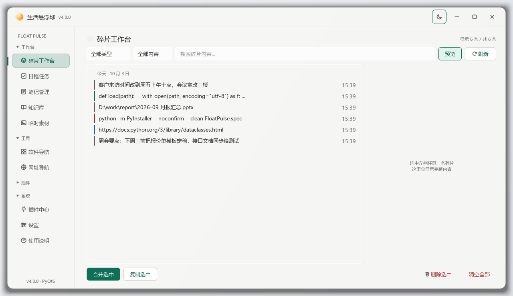
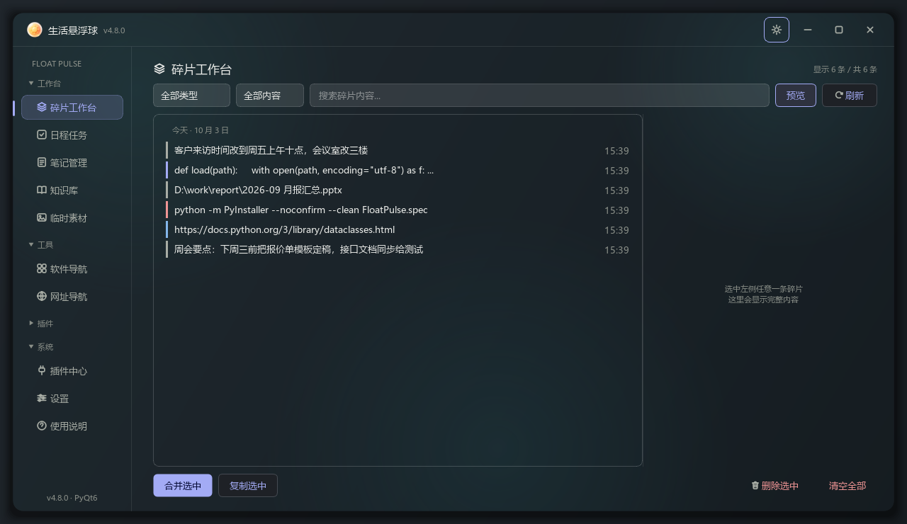
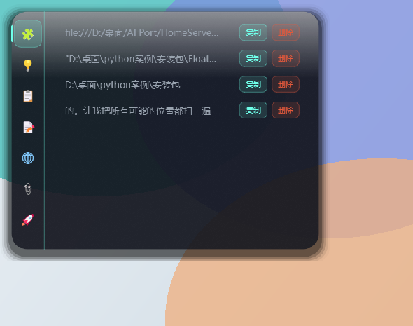

# FloatPulse · Floating Life Companion

[中文](README.md) | **English**

[](https://github.com/2026heshao/FloatPulse/actions/workflows/tests.yml)
[](https://github.com/2026heshao/FloatPulse/releases/latest)
[](https://github.com/2026heshao/FloatPulse/releases)
[](LICENSE)
[](#requirements)
[](requirements.txt)
[](https://pypi.org/project/PyQt6/)

**A always-on-top floating ball for Windows that catches the little things you copy, drag or screenshot — clipboard snippets, temp assets, pinned reference shots — so they stay one hover away for the next half hour instead of getting lost in chat history.**

Native PyQt6 widgets + QSS. No Electron, no bundled browser engine. ~31 MB download, ~1 s cold start.

| Main window (light · out of the box) | Main window (dark · custom accent + wallpaper) |
| ------- | ------- |
|  |  |

> **UI language: Chinese only for now** (the app is Chinese-first; i18n is on the roadmap). The architecture, plugin API and tests are language-neutral.

---

## Table of contents

- [Why another launcher / clipboard tool?](#why-another-launcher--clipboard-tool)
- [Features](#features)
- [Plugins (opt-in, downloaded separately)](#plugins-opt-in-downloaded-separately)
- [Quick start](#quick-start)
- [Requirements](#requirements)
- [Default hotkeys](#default-hotkeys)
- [Build & release](#build--release)
- [Project layout](#project-layout)
- [Architecture](#architecture)
- [Roadmap](#roadmap)
- [Contributing](#contributing)
- [License](#license)

---

## Why another launcher / clipboard tool?

Launchers help you *find* things. Screenshot tools help you *look* at things. FloatPulse is the place where **the stuff you just copied, dragged or captured temporarily lives** — an IP address, a file path, a screenshot you just took, a command you'll need again in ten minutes. Most of it has a half-life of about thirty minutes, but during that window you need to glance at it again without digging through a chat log or re-taking the screenshot.

It is deliberately **not** your second brain. Fragments go in looking exactly like they came in; the only things that persist are the ones you explicitly promote to a note, push into the knowledge base, or export to Obsidian.

| Capability | FloatPulse | FocusCapture | Floatyball | Flow Launcher | Snipaste |
| ------------ | ----------------------- | ------------ | ---------- | -------------- | -------- |
| Always-available floating ball | ✅ | ✅ | ✅ | ❌ | ❌ |
| Frictionless capture | ✅ clipboard-first + drag-drop | ✅ clipboard | ⚠️ drag-drop | ❌ | ❌ |
| Fragment classification | ✅ source + content semantics | ❌ time stream only | ❌ | ❌ | ❌ |
| Promote to note / knowledge base | ✅ one click | ❌ | ❌ | ❌ | ❌ |
| Temp asset staging | ✅ dedupe + thumbs + expiry | ❌ | ❌ | ❌ | ❌ |
| Screenshot pin | ✅ with annotation + undo | ❌ | ❌ | ❌ | ✅ |
| App / URL launcher | ✅ drop an .exe to create | ❌ | ✅ AHK actions | ✅ | ❌ |
| AI summarise / chat | ✅ optional, local + cloud | ❌ | ❌ | ❌ | ❌ |
| Global file search | ❌ | ❌ | ❌ | ✅ via Everything | ❌ |
| Plugin ecosystem | ⚠️ 5 external plugins, opt-in | ❌ | ❌ | ✅ 200+ | ❌ |
| Themes / wallpaper | ✅ 8 accents + custom HEX + 5 background modes | ❌ | ❌ | ⚠️ themes | ❌ |
| Stack | Python + PyQt6 | C# / WPF | AutoHotkey | C# / .NET | closed |

**The ❌ marks are trade-offs, not defects.** Global file search is left to Everything and Flow Launcher — they are faster and have better query syntax, so re-building it would be pointless; the plugin ecosystem is young (5 bundled plugins plus a store and a packer) and we do not pretend otherwise.

**What it is not for** — better to say this up front than have you install it and be disappointed:

| If you want | Reality |
| --------------- | -------------------------------------- |
| Global file search | ❌ Use Everything / Flow Launcher, they do it better |
| Cross-device / mobile sync | ❌ Single machine, single user, no server, and that is by design |
| A replacement for your notes app | ❌ It is a staging area; long-form writing belongs in Obsidian / Notion |
| AI that works out of the box | ❌ AI is an optional plugin capability — with no key and no local server it never touches the network |
| macOS / Linux | ❌ Windows 10/11 only, and the UI is Chinese-only today |

---

## Features

### 🎨 Themes / wallpaper

- **8 accent presets + custom HEX**, with 17 derived tokens (hover, pressed, outline, selection) recomputed live across every window
- **5 background modes** (cover / contain / stretch / tile / center) plus adjustable **blur** and a **theme-tint overlay**, so text on the glass stays readable over any wallpaper
- Applies to both the main window and the floating quick-card; wallpapers stay local in `float_data/backgrounds/` and are never uploaded

### 🎈 The floating ball

- Draggable, edge-snapping, auto-reveals on approach, hides while a fullscreen app is in front
- Hover to pop a 440×340 quick card; scroll to flip cards
- Drag a file onto it → captured into the fragment pool; drag an `.exe` / `.lnk` → creates an app launcher
- **Screenshot pin (`Ctrl+Alt+S`)**: select any screen region and pin it as an always-on-top reference window; scroll to zoom, drag the grip to resize, annotate (pen / arrow / mosaic, `Ctrl+Z` to undo), right-click to copy or save



### 🃏 Quick cards (three modes)

| Mode | Behaviour |
| ------- | -------------------------------- |
| 📚 Knowledge card | Random knowledge-base paragraph for quick reference; auto-closes on hover-out |
| 📋 Tasks | Input row + task list grouped by deadline (overdue / today / this week / later) |
| 📝 Quick note | A single note with 800 ms debounced autosave |

### 🤖 AI assistant (optional plugin, local or cloud)

- **Three backends behind one OpenAI-compatible config**: cloud (DeepSeek / SiliconFlow…), local Ollama, or **self-hosted llama-server** launched by the plugin with a `.gguf` model you point it at — fully offline-capable, nothing leaves the machine
- **Consent-gated networking**: a plugin must declare `capabilities: ["network"]` in its manifest to touch the network at all, and can only do so through the host bridge — plugins never get a network library. Requests log only URL and latency, into an auditable `app.log`
- With no key configured and no local server started, everything else behaves exactly as before

### 🖥 Main window (ten pages, four collapsible sidebar groups)

Sidebar groups are **工作台 / 工具 / 插件 / 系统** (Workbench / Tools / Plugins / System); multiple groups can be open at once and the expanded set is remembered across restarts. When the window is too short the sidebar scrolls instead of squashing buttons.

| Group | Pages |
| --- | --- |
| Workbench | 🧩 Fragments (auto-collected clipboard text / paths / files / knowledge paragraphs; filter by source and by content semantics; search, merge, promote to note / knowledge base / Obsidian) · 📋 Tasks (overdue flags, relative deadlines, undo bar, 🍅 pomodoro) · 📝 Notes (list + editor + autosave) · 📚 Knowledge base (docx-backed, external-change detection, incremental sync) · 📎 Temp assets (drag-in, thumbnails, sha256 dedupe, expiry) |
| Tools | 🌐 URL bookmarks · 🚀 App launcher (local shortcuts, icon extraction, one-click launch) |
| Plugins | Every page plugin, **installed on demand** (see below) |
| System | 🔌 Plugin centre (install / enable / uninstall / store) · ⚙️ Settings · ❓ Help |

### 🛡 Engineering notes

- Layered UI / domain / data architecture with strict decoupling
- Atomic JSON writes (temp file + `os.replace`) with corruption fallback
- Windows mutex single-instance guard, global exception hook, multi-monitor and DPI-drift tolerance
- Light/dark theme system (QSS templates + colour dictionary) with contrast-ratio test guards
- pytest suite plus offscreen GUI verification scripts (the suite is the reason regressions here get caught rather than shipped)

---

## Plugins (opt-in, downloaded separately)

**The main package ships with no plugins at all.** You probably want one or two features, not all of them — so plugins are downloaded individually. Installing none of them leaves every core feature intact.

**Three steps:**

1. Download the `.fpplug` you want from the table below (each is only 10–40 KB), or pick from the [Releases](https://github.com/2026heshao/FloatPulse/releases) Assets section
2. Drop it into the `plugin_store\` folder next to the executable (do not unzip, do not rename)
3. Launch → Plugin centre → 🏪 Plugin store → Install. It takes effect immediately, no restart

**Or use the in-app marketplace**: click "🌐 Check online marketplace" inside the plugin store dialog, and it lists the official index with anything you have not installed yet, one click to download (sha256-verified, then the same install path). It only reaches GitHub when you click, so offline local installs are unaffected.

| Package | Page / hotkey | Capabilities | What it does |
| --- | --- | --- | --- |
| [ai-assistant.fpplug](https://github.com/2026heshao/FloatPulse/releases/latest/download/ai-assistant.fpplug) | 🤖 AI assistant / `Ctrl+Alt+I` | 🌐 ✍ 🛠 🧠 | Chat assistant over your own tasks, fragments and notes; local llama-server supported for fully offline use |
| [ai-text-workshop.fpplug](https://github.com/2026heshao/FloatPulse/releases/latest/download/ai-text-workshop.fpplug) | ✂ Text workshop / `Ctrl+Alt+T` | 🌐 ✍ 🧠 | One-click AI processing of the clipboard: polish into an email, translate, summarise, extract to-dos as tasks |
| [kb-search.fpplug](https://github.com/2026heshao/FloatPulse/releases/latest/download/kb-search.fpplug) | 🔍 In-app search / `Ctrl+Alt+F` | read-only | Full-text search across five data types — hand-rolled Chinese segmentation + inverted index + BM25 (`Ctrl+K` routes here) |
| [recurring-tasks.fpplug](https://github.com/2026heshao/FloatPulse/releases/latest/download/recurring-tasks.fpplug) | 🔁 Recurring tasks / `Ctrl+Alt+R` | ✍ | Give a rule (daily / weekday / day-of-month / every N days) and tasks generate themselves on schedule |
| [vault.fpplug](https://github.com/2026heshao/FloatPulse/releases/latest/download/vault.fpplug) | 🔒 Password vault / `Ctrl+Alt+V` | read-only | Local-only vault: custom fields for credentials and secrets, DPAPI + master-password two-factor encryption, `Ctrl+Alt+B` quick retrieval, clipboard auto-cleared after 30 s |
| [weekly-report.fpplug](https://github.com/2026heshao/FloatPulse/releases/latest/download/weekly-report.fpplug) | Weekly report / `Ctrl+Alt+W` | read-only | Summarises completed tasks, fragments and pomodoro counts for a range into a Markdown draft |

> Capability markers: 🌐 goes online via the host (URL + latency logged) · ✍ can add data · 🛠 can modify/delete data (deletes return an undo token) · 🧠 can reuse the shared backend from Settings → AI. Plugins have no network library of their own, and calls to undeclared capabilities are rejected outright.

**Writing your own**: dependencies are limited to PyQt6 plus the Python standard library; package it with `python tools/pack_plugin.py plugins/<dir>` and distribute the `.fpplug`.

---

## Quick start

### Option 1 — launcher (recommended on Windows)

Double-click **`启动v4.bat`** in the project root:

| Command | Behaviour |
| ---------------- | -------------------- |
| `启动v4.bat` | Starts v4 with a live console log |
| `启动v4.bat quiet` | Starts in the background with no console window (daily use) |

The launcher detects a Python that already has PyQt6 and self-checks dependencies.

### Option 2 — command line

```bash
pip install -r requirements.txt
cd v4
python knowledge_ball.py
```

Or just grab the packaged build from [Releases](https://github.com/2026heshao/FloatPulse/releases/latest) — no Python required on the target machine.

---

## Requirements

- **Windows 10 / 11** (x64)
- Python **3.10+** when running from source
- `PyQt6==6.7.1`, `python-docx==1.1.2` (see `requirements.txt`)

---

## Default hotkeys

| Hotkey | Action |
| ------------ | ----------------------------- |
| `Ctrl+Alt+S` | Screenshot pin (select a region, pin it on top, annotate) |
| `Ctrl+K` | In-app search (provided by the `kb-search` plugin, install first) |
| `Esc` | Close the card / cancel screenshot |

---

## Build & release

PyInstaller **onedir** mode (faster start-up, fewer false positives):

```bash
pip install pyinstaller
python -m PyInstaller --noconfirm --clean --distpath dist2 --workpath build2 FloatPulse.spec
```

Copy the whole `dist2\FloatPulse\` folder — the target machine needs no Python.

**Assemble release packages with the script, never by hand** (`tools/build_release.py`, standard library only):

```bash
python tools/build_release.py --dry-run   # dry run: show what goes in and what is excluded
python tools/build_release.py             # produces 宣传页/FloatPulse-v<version>-win64.zip
```

It does four things hand-zipping tends to get wrong:

- **Whitelist collection** (`FloatPulse.exe` and `_internal/` only), keeping developer-machine personal data out of the package; `float_data/` is excluded too, so your knowledge base never ships
- **No bundled plugins**: ships empty `plugins\` and `plugin_store\` directories plus an install note; finding a `.fpplug` or `plugins/<subdir>` in the archive fails the build
- **Re-opens and self-verifies the zip** (missing exe / missing directory / leaked data all fail), printing size and SHA-256
- Generates `SHA256SUMS.txt` and copies plugin assets for the Release

**Release pipeline**: pushing a `v*` tag triggers `.github/workflows/release.yml`, which runs a three-source consistency check (`APP_VERSION` ↔ CHANGELOG ↔ tag) and refuses to publish on drift, builds the zip, compiles an Inno Setup `setup.exe` via choco, and uploads everything with checksums.

---

## Project layout

```
FloatPulse/
├── v4/                # Main source tree: app, tests, offscreen verification scripts
├── plugins/           # External plugin sources (one dir per plugin; empty in release packages)
├── assets/images/     # README screenshots
├── tools/             # Engineering scripts (pack a plugin / assemble a release / pre-release checks)
├── shared/            # Icons, packaging spec, bundled install note
└── 启动v4.bat          # Launcher
```

`dist2/` (build output) and `宣传页/` (release artifacts) are gitignored — the former is reproducible, the latter lives on GitHub Releases.

Runtime data lives in `float_data/` (including `temp_assets/` and `知识库.docx`), resolved two ways depending on the distribution form: the **portable zip** keeps data next to the exe, while the **installer** uses `%APPDATA%\FloatPulse\float_data\` so upgrades and re-installs never lose it. On first launch the installer build offers to migrate legacy data and keeps a backup.

---

## Architecture

```
UI        FloatingBall / CardWindow / MainWindow / ten pages (index 0–9)
Domain    TaskManager / NoteManager / FragmentManager / DocxManager
          ClipboardMonitor / TempAssetManager / ConfigManager / Hotkey
Data      docx + 8 JSON stores (atomic writes / corruption fallback / incremental fingerprints)
```

Core test commands:

```bash
cd v4
python -m pytest tests/ -q     # logic layer + guard-rail tests
python test_init.py            # start-up smoke test
```

---

## Roadmap

- [x] v4: screenshot pin, open-source packaging
- [x] Obsidian Markdown export (notes / fragments / tasks → vault; read-only, idempotent)
- [x] External plugin system: capability declarations (`network` / `write` / `manage` / `ai`), page plugins, store, packer
- [x] Four-group collapsible sidebar (multiple groups open at once, animated, scrolls when overflowing)
- [x] On-demand plugin distribution: nothing bundled, per-package download from Releases
- [ ] `/` command palette (search as the entry point)
- [ ] UI internationalisation (English first)

---

## Contributing

Issues and pull requests are welcome — see [CONTRIBUTING.md](CONTRIBUTING.md).
Please run the test suite before submitting; UI changes should include an offscreen screenshot (`tools/run_gui_check.py`).

## License

[MIT](LICENSE) © 2026 FloatPulse Contributors
